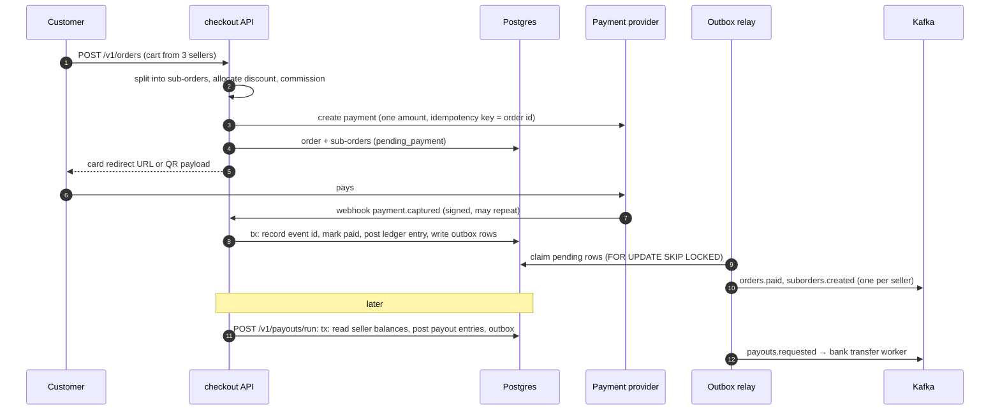
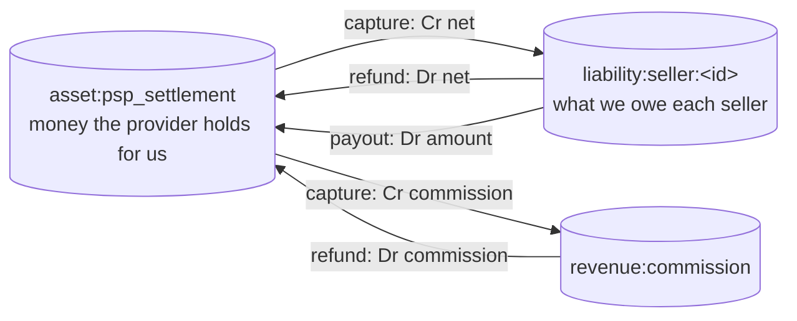

# marketplace-split-payments

A Go service for multi-seller marketplace checkout: **one cart with items from several sellers → one payment → per-seller sub-orders → commission → double-entry ledger → payouts → partial refunds.**

The patterns come from multi-seller marketplaces we built in Central Asia, on local card and bank-QR payment rails. This repository is a self-contained demonstration of how we structure that money flow; it is not a product.

## The problem

The customer pays once. The acquirer sees a single amount. Behind it are several sellers, each with their own commission rate, a promo discount that has to be shared between them, and returns that arrive item by item, sometimes after the seller has already been paid. Every one of these steps divides money, and every division is a chance to lose or invent a tiyn. The ledger must still balance to zero, webhooks arrive twice, and the broker is sometimes down.

## Flow



## Ledger

Every movement of money is a balanced journal entry. Postings are signed (debit positive, credit negative), so each entry, and therefore the whole book, sums to zero.



Worked example, 10% commission, 1 000 promo discount:

| | sneakers 2 × 12 000 (shoes) | novel 1 × 9 000 (books) | total |
|---|---:|---:|---:|
| subtotal | 24 000 | 9 000 | 33 000 |
| discount share | 727 | 273 | 1 000 |
| gross (customer paid) | 23 273 | 8 727 | 32 000 |
| commission | 2 327 | 873 | 3 200 |
| net (owed to seller) | 20 946 | 7 854 | 28 800 |

| entry | settlement | seller:shoes | seller:books | commission |
|---|---:|---:|---:|---:|
| capture | +32 000 | −20 946 | −7 854 | −3 200 |
| refund novel | −8 727 | | +7 854 | +873 |
| payout shoes | −20 946 | +20 946 | | |
| **balance** | **2 327** | **0** | **0** | **−2 327** |

What is left in settlement is exactly the commission the platform earned.

## Design decisions

**Integer money.** `money.Amount` is an `int64` of minor units. No floats anywhere. Every division names its rounding rule: commission rounds half up once per sub-order; proportional splits use the largest-remainder method so the parts always add back to the whole. Intermediate products use 128-bit arithmetic (`math/bits`), so large carts cannot overflow.

**Sub-orders.** One payment, but fulfilment, commission, refunds and payouts are all per seller. A sub-order is the unit a seller sees and is paid for. The order-level discount is allocated per *line*, not per seller, so a later partial return knows what each unit really cost the customer.

**Refunds without drift.** Returns are priced from running totals: refunding units *a..b* of a line costs `paid(b) − paid(a)`, where `paid(q) = ⌊Paid·q/Qty⌋`. Returning a line in any number of steps adds up to exactly what was paid, and the commission reversed adds up to exactly what was charged. The tests return orders unit by unit and check that every account goes back to zero.

**Double-entry, enforced twice.** Entries are validated in Go before posting. In Postgres, a deferred constraint trigger rejects any entry that does not sum to zero at commit, and the ledger tables are append-only. Each entry has a unique business reference (`capture:<order>`, `refund:<id>`, `payout:<id>`), so the same event cannot be booked twice.

**Payouts from balances.** Payouts are computed from seller ledger balances, not from sub-order totals. A refund that lands after the seller was paid simply leaves a negative balance, which is netted against their next sales. Payout runs are serialised with an advisory lock.

**Idempotent webhooks.** Providers deliver at least once and retry concurrently. The webhook's event ID is inserted (`ON CONFLICT DO NOTHING`) in the same transaction as its effects. A duplicate either sees the row and does nothing, or waits on the first delivery's lock and then sees it. Signatures are HMAC-SHA256 over timestamp and body, with a replay window.

**Idempotent refunds.** Callers send an `Idempotency-Key`. The provider refund is called under the order lock with a key derived from it, so a retry after a failed commit is a no-op at the provider and is booked once here.

**Transactional outbox.** Events are rows written in the business transaction. A relay publishes them to Kafka and marks them sent. Publishing directly from the handler would either lose events when the broker is down or emit events for transactions that roll back. Delivery is at least once; each record carries the outbox ID in a `message-id` header for consumer deduplication, and is keyed by order or seller to keep per-key ordering.

**Ports and adapters, kept small.** `payment.Provider`, `outbox.Publisher` and `checkout.Store` are interfaces with production (Postgres, Kafka) and in-memory implementations. Domain packages (`money`, `order`, `ledger`, `payout`) have no I/O and are tested with table-driven tests.

## Layout

```
cmd/api                 HTTP server, config, outbox relay, graceful shutdown
internal/money          Amount, basis-point rates, largest-remainder allocation
internal/order          orders, split into sub-orders, commission, refund quotes
internal/ledger         double-entry entries and balances
internal/payout         payout planning from seller balances
internal/payment        provider interface; fake/ is a card + QR provider with signed webhooks
internal/outbox         relay, publisher interface; kafka/ is the franz-go producer
internal/checkout       use cases: place order, webhook, refund, payouts
internal/storage        memory/ for tests, postgres/ (pgx) with migration runner
internal/api            net/http handlers
migrations              SQL schema
```

## Running

Requires Go 1.22+ and Docker.

```sh
make up      # Postgres (add --profile kafka for Redpanda)
make run     # API on :8080 with the payment simulator enabled
```

```sh
curl -s localhost:8080/v1/orders -d '{
  "customer_id": "c1", "currency": "KZT", "discount": 1000, "method": "qr",
  "lines": [
    {"sku": "sneakers", "seller_id": "shoes", "qty": 2, "unit_price": 12000},
    {"sku": "novel",    "seller_id": "books", "qty": 1, "unit_price": 9000}
  ]}'

curl -s -X POST localhost:8080/dev/payments/<payment_id>/capture    # simulate the customer paying
curl -s localhost:8080/v1/orders/<order_id>
curl -s localhost:8080/v1/orders/<order_id>/refunds -H 'Idempotency-Key: rma-1' \
  -d '{"lines": [{"line_id": "<line_id>", "qty": 1}]}'
curl -s localhost:8080/v1/payouts/run -d '{"currency": "KZT", "minimum": 100}'
```

Without `KAFKA_BROKERS` the relay logs events to stdout.

## Testing

```sh
make test        # everything, with -race
make test-unit   # skips the Postgres integration tests
make lint
```

Unit tests cover allocation and rounding edge cases, commission per seller, randomised carts whose ledger must always balance, refunds of one seller's items, stepwise returns with no rounding drift, refunds after payout, and concurrent duplicate webhooks. Integration tests start Postgres with testcontainers-go, clone a migrated template database per test, and check concurrency and database-level invariants: duplicate webhooks book once, concurrent payout runs pay once, unbalanced entries are rejected by the database, the ledger cannot be edited. They skip automatically when Docker is unavailable.

## Out of scope

Real acquirer integrations, delivery-based payout holds, multi-currency settlement and FX, seller onboarding, authentication. Each would plug into the existing interfaces without changing the money model.

## License

MIT
